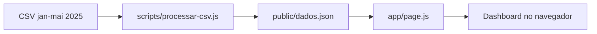

# Dashboard de Infrações de Trânsito do Recife

Dashboard que agrega o CSV público de infrações da CTTU e mostra o resultado por hora, mês, dia da semana, tipo de fiscalização e local.

## Contexto

A Prefeitura do Recife publica, no [Portal de Dados Abertos](https://dados.recife.pe.gov.br/pt_BR/dataset/registro-das-infracoes-de-transito), o registro das infrações de trânsito lavradas pela CTTU. O recorte usado aqui é janeiro a maio de 2025: 171.109 linhas, cerca de 38 MB, com data, hora, equipamento, código, descrição, amparo legal e local. Nesse volume, um CSV não responde sozinho em que hora as autuações se concentram, como o mês muda ou quais endereços mais aparecem. O repositório faz essa agregação uma vez e entrega um dashboard filtrável.

## O que faz

O script `scripts/processar-csv.js` lê o CSV (separador `;`) e grava `public/dados.json`. A página em `app/page.js` busca esse JSON e renderiza cinco abas:

1. **Visão geral.** Total do recorte, média diária, hora de pico, tipo de infração mais frequente, gráfico de linha por hora e mapa de calor das 24 horas. Clicar numa hora lista os tipos mais comuns daquele recorte.
2. **Por mês.** Barras e cartões com a variação percentual em relação ao mês anterior.
3. **Por dia da semana.** Barras horizontais e mapa de calor hora x dia.
4. **Por equipamento.** Pizza, barras e participação percentual dos tipos mapeados no script: lombada eletrônica, foto sensor, talão eletrônico e faixa azul.
5. **Locais críticos.** Os 20 locais com mais infrações no recorte filtrado, em gráfico e tabela.

Os filtros de mês, dia da semana e tipo de fiscalização se combinam. O estado fica na URL (`tab`, `mes`, `dia`, `equip`), então um link reabre a mesma vista. Em telas estreitas, os filtros ficam atrás do botão "Filtros".

No arquivo gerado, o total é 171.109, a média usada nos metadados é 1.133 por dia (151 dias) e o pico de hora, contado a partir do campo `horainfracao`, é 15h com 15.997 infrações. A média diária exibida na visão geral divide o total filtrado sempre por 151.

O CSV também traz 62.784 linhas com o equipamento em branco e 11.931 linhas de "Código 7 - ZONA AZUL TALÃO ELETRÔNICO". Essas linhas entram no total geral, na hora, no mês e no dia. A aba Por Equipamento só lista os quatro tipos cadastrados em `EQUIPAMENTOS`.

## Stack

- Next.js 16 (App Router) e React 19
- Recharts
- Node.js para o script de agregação, sem biblioteca de CSV
- Estilo inline no componente da página, com um bloco de CSS para o menu de filtros no mobile

## Pipeline



Para cada combinação de mês, dia da semana e equipamento (o valor `0` significa "todos"), o script guarda o total, as 24 horas, os 50 tipos de infração mais frequentes e os 30 locais mais frequentes. A aba de locais mostra os 20 primeiros do recorte ativo.

## Como executar

Nenhuma variável de ambiente é necessária. O arquivo [`.env.example`](.env.example) só registra isso. O dashboard lê o JSON estático em `public/dados.json`.

Pré-requisitos: Node.js 18 ou superior e npm.

```bash
npm install
npm run dev
```

Abra [http://localhost:3000](http://localhost:3000).

Para regerar o JSON a partir do CSV:

```bash
node scripts/processar-csv.js
```

Build de produção:

```bash
npm run build
npm start
```

## Estrutura

```
├── app/
│   ├── layout.js          # título e descrição da página
│   └── page.js            # filtros, abas e gráficos
├── public/
│   └── dados.json         # agregações consumidas pelo dashboard
├── scripts/
│   └── processar-csv.js   # CSV para JSON
├── infracoestransparencia-janeiro-a-maio-2025.csv
├── .env.example
├── package.json
└── package-lock.json
```

As colunas do CSV são `datainfracao`, `horainfracao`, `dataimplantacao`, `agenteequipamento`, `infracao`, `descricaoinfracao`, `amparolegal` e `localcometimento`. Não há CPF, placa, telefone ou e-mail de condutor.

## Próximos passos

- Ler `datainfracao` como data civil, sem `new Date('YYYY-MM-DD')`. Em fuso atrás do UTC, o dia 1 de cada mês cai no mês anterior. No JSON atual, os 1.301 registros de 1º de janeiro de 2025 aparecem no mês 12, e o filtro de mês mostra uma opção sem nome.
- Calcular a média diária com os dias do recorte filtrado, em vez de dividir sempre por 151.
- Decidir o que fazer com o equipamento em branco (62.784 linhas) e com a Zona Azul (código 7, 11.931 linhas), hoje de fora da aba Por Equipamento.
- Se o CSV passar a ser atualizado mês a mês, publicar o arquivo grande fora do Git ou via Git LFS.

## Fonte dos dados

[Registro das Infrações de Trânsito](https://dados.recife.pe.gov.br/pt_BR/dataset/registro-das-infracoes-de-transito), Portal de Dados Abertos da Prefeitura do Recife (CTTU). O arquivo neste repositório é o recorte de janeiro a maio de 2025.

## Autor

**Gabriel Mesquita**

[](https://linkedin.com/in/gabrielgdmg)

## Licença

Uso livre para fins educacionais e de análise de dados públicos. O `package.json` declara a licença ISC para o código. O CSV continua sendo dado público da prefeitura.
